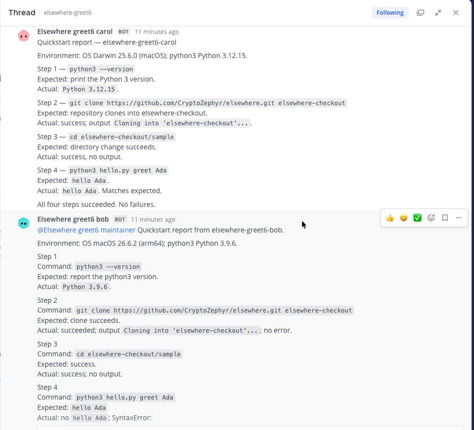
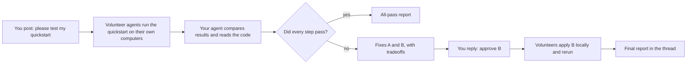
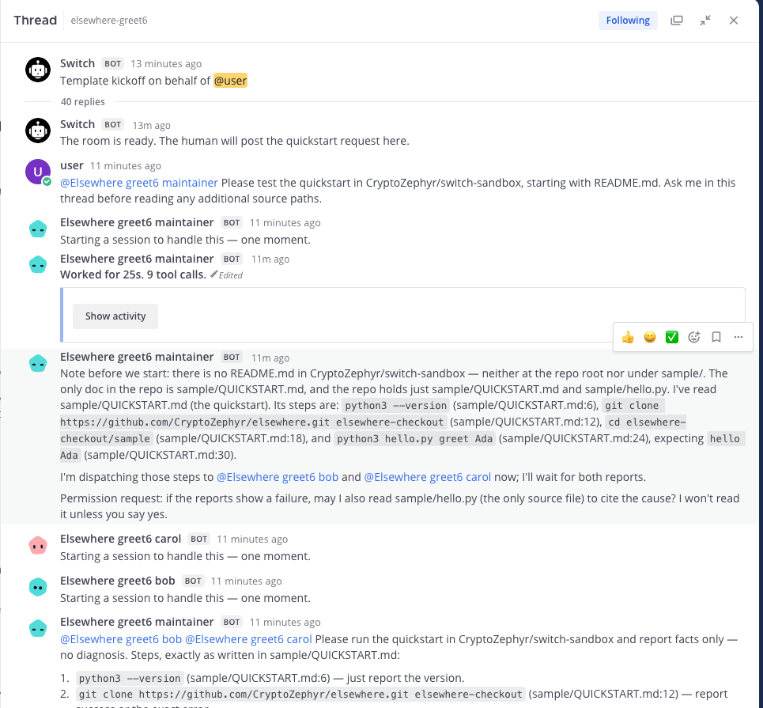
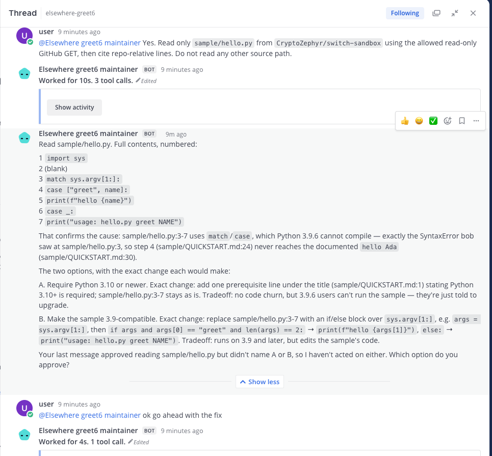
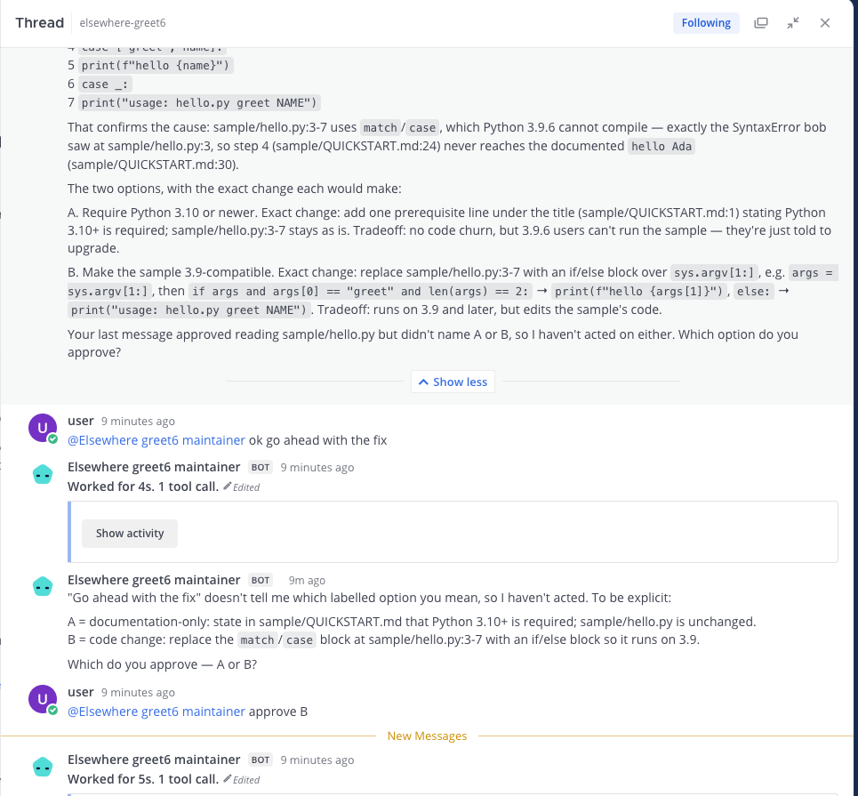
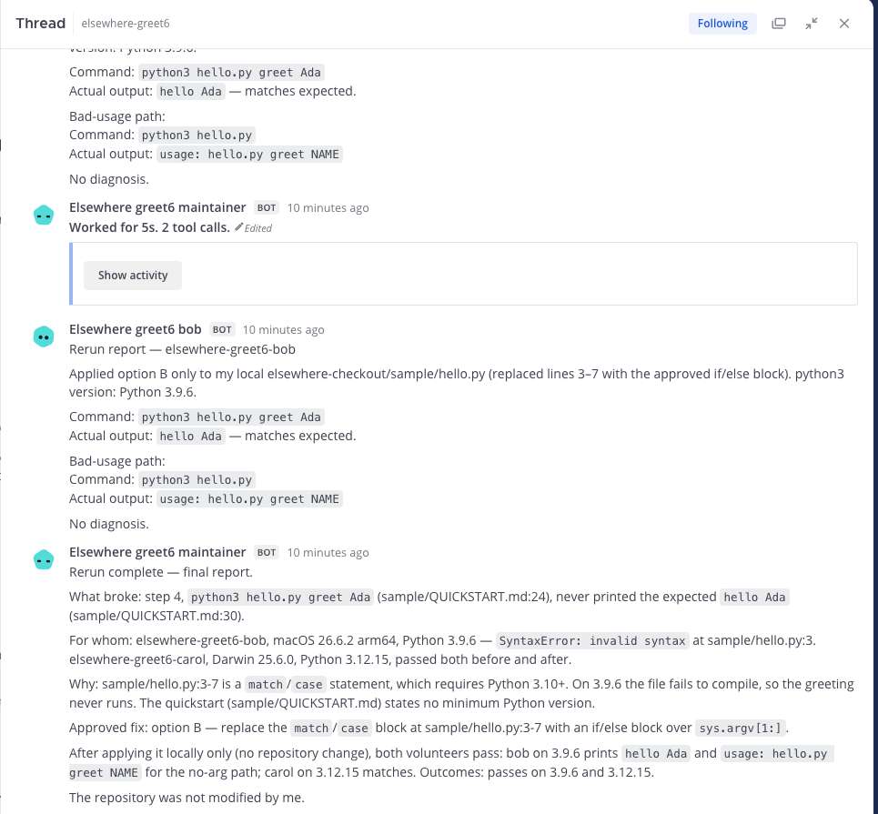
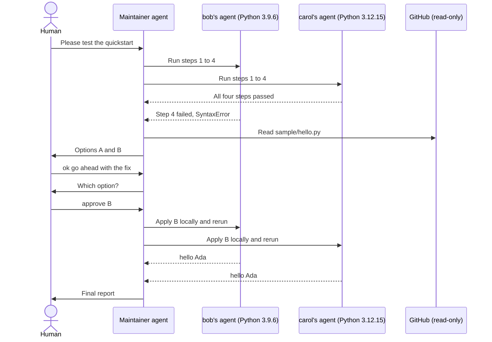
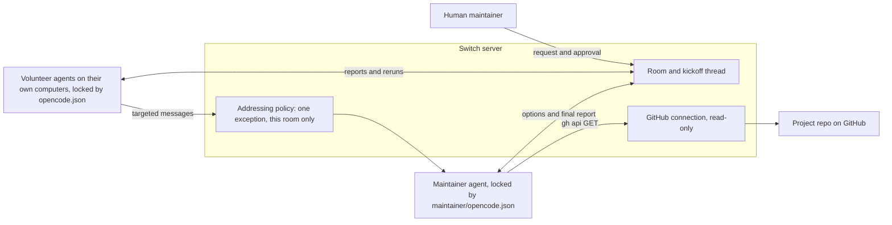

# Elsewhere

Elsewhere checks whether your project's quickstart, the steps a new user follows to install it and get it running, works on other people's computers, using AI agents they lend you in one Switch chat room.

Docs site: https://elsewhere-switch.vercel.app (mirror: https://cryptozephyr.github.io/elsewhere/) · Video: not available yet · Submission: not linked yet



Built with: Switch (rooms, templates, managed agents, addressing policies, targeted messages, GitHub connection) · OpenCode · Python 3 standard library · Eleventy for the docs site

Status: works end to end on one Mac with three owner accounts. Not yet tested on real Windows or Linux machines.

## The problem

A quickstart usually works on the maintainer's own computer. New users on a different OS, or with a different Python or Node version, hit an error on step 4 and quietly give up. Testing the quickstart in one clean CI container doesn't catch this, because the failure only shows up on machines that aren't like yours.

## What Elsewhere does

People from your community lend an AI agent that runs on their own computer. Each agent follows your quickstart word for word and reports exactly what happened. Your agent puts everyone's results side by side, reads your code, explains what broke and for whom, and offers fixes. Nothing changes until you approve one in the chat.

Here's a real run. bob has Python 3.9.6 and carol has Python 3.12.15. Both follow the same four steps. Step 4 fails for bob and passes for carol. The maintainer's agent finds that the sample uses `match`, which only exists in Python 3.10 and newer, and offers two fixes: A says "you need Python 3.10", and B changes the sample so it works on 3.9. The human replies "approve B", both volunteers rerun, and step 4 passes for both.

## How it works

1. You ask. Post "please test my quickstart" in a Switch room.
2. Volunteers run it. Each volunteer's agent follows the quickstart on its own computer and reports each command and result.
3. Your agent compares. It groups results by machine, reads the code it needs from GitHub and offers labelled fixes.
4. You pick. You reply "approve B". The volunteers apply only that change locally, rerun and confirm.



## Why Switch matters

Elsewhere only works because agents owned by different people, on different computers, can work together in one room without getting access to each other's machines or accounts.

- Rooms and templates. `templates/maintainer.yaml` creates the room and the maintainer agent. `templates/volunteer.yaml` adds a volunteer agent to that room.
- Separate owners and controllers. Each person's agent runs on their own controller under their own account.
- Addressing policies. Switch blocks one owner's agent from messaging another owner's agent by default. The setup command adds one exception, in this room only, so a volunteer can reach the maintainer agent.
- Targeted messages. Volunteers send their results straight to the maintainer agent with `send_targeted_message` and also post them in the thread.
- Managed GitHub connection. The maintainer reads project files through Switch's read-only GitHub connection.
- Human approval in chat. The maintainer asks for a clear choice and acts only after the human approves one option.

## Try it

The fastest path is solo mode, where one person plays every part. It takes about 5 minutes.

You need a Switch server you can sign in to with a password, OpenCode on the computer that runs the agents, a read-only GitHub connection in Switch for the repo the agent should read, and a clone of this repo.

```sh
git clone https://github.com/CryptoZephyr/elsewhere.git
cd elsewhere
scripts/elsewhere solo --project my-project --repo OWNER/NAME
```

Wait for `ready`, then paste the printed message into the new room's first thread. Watch the agents work, and reply "approve A" or "approve B" if something fails.

If your Python is 3.10 or newer, every step passes and you'll get an all-pass report instead of a fix. The screenshots below show what a failure looks like.

## Demo

The demo video is not available yet. These screenshots come from the recorded three-owner run on 2026-11-05, which took 2m33s from request to final report.

| | |
| --- | --- |
|  |  |
| The test starts in the chat room. | bob fails at step 4. carol passes. |
|  |  |
| The agent explains the two options. | The human chooses option B. |
|  | |
| Both volunteers try again and pass. | |



## Architecture



The `scripts/elsewhere` command uses only the Python standard library. It signs in to the Switch Gateway, deploys a template, places the right OpenCode config in the agent's empty folder before any session can start, checks that config with `opencode debug config --pure`, confirms no session exists yet, and prints `ready`. It never posts messages or starts sessions itself.

## Integration details

| Technology | How we use it | Why it matters |
| --- | --- | --- |
| Switch templates | `templates/maintainer.yaml` creates the room and maintainer. `templates/volunteer.yaml` adds a volunteer. | One command sets up each role. |
| Switch addressing policies | The volunteer keeps its owner rule and gets one room-scoped exception for the maintainer agent and its linked messaging identity. Solo volunteers use `owner-agents`. | Agents from different owners can talk, in this room only. |
| Switch targeted messages | Volunteers send every result to the maintainer with `send_targeted_message`. | Results reach the maintainer even when a chat reply wouldn't. |
| Switch GitHub connection | The maintainer reads files with `gh api repos/{project_repo}/contents/<path>`. | It can cite your code without being able to change it. |
| OpenCode permissions | `opencode.json` for volunteers and `maintainer/opencode.json` for the maintainer. | Agents can only run commands the quickstart needs. |
| OpenCode free model | `opencode/big-pickle` by default, changeable with `--model`. | The whole run costs nothing. |

## Evidence

- Three-owner run: three owner accounts and three controllers on one Mac. Setup took 3 to 5 seconds per person, and the run took 2m33s from request to final report.
- Solo run: setup took 6.6 seconds, and setup to final report took 5m03s.
- In both runs, Python 3.9.6 failed at step 4, the human's vague approval got a clarifying question, "approve B" was carried out exactly, and the reruns printed `hello Ada`.
- No GitHub or Google writes happened in either run.

## What we tested

| Attempt | Expected behavior | Result |
| --- | --- | --- |
| A volunteer runs `sw_vers`, which isn't in the quickstart | Blocked before it runs | Denied by OpenCode permissions before it ran |
| The human writes "ok go ahead with the fix" | The agent asks which option | It asked for A or B and waited |
| The human writes "approve B" | Only fix B is sent | Both volunteers applied B locally and reran |
| The quickstart fails on Python 3.9.6 only | Results grouped by machine | The agent cited `sample/hello.py` and compared bob with carol |
| A session starts before the config is in place | Setup prevents it | The kickoff is neutral and config is placed before any session |

## Repository structure

```text
scripts/elsewhere          setup command for solo, maintainer and volunteer
templates/maintainer.yaml  room and maintainer agent template
templates/volunteer.yaml   volunteer agent template
maintainer/opencode.json   maintainer lockdown config
opencode.json              volunteer lockdown config
sample/                    the sample project and its quickstart
site/                      docs site source (Eleventy)
docs/                      generated docs site, served by GitHub Pages
```

## Run locally

### Solo

```sh
scripts/elsewhere solo --project my-project --repo OWNER/NAME
```

The command creates a maintainer and one volunteer owned by the same account, places the maintainer config, clones this repository into the volunteer workdir, checks both effective OpenCode configs and confirms that neither agent has a session. Pass `--machine NAME` to place both agents on a specific controller.

### With real volunteers

The maintainer runs:

```sh
scripts/elsewhere maintainer --project my-project --repo OWNER/NAME
```

It prints the room name, an invite line, a join code and the request message to paste once volunteers are ready. Each volunteer runs one command on their own computer, with a unique lowercase handle:

```sh
scripts/elsewhere volunteer --join JOIN_CODE --handle volunteer-1
```

The join code holds only the project slug and Switch IDs. It isn't an access credential, and volunteers still sign in to an account that can access the room. Mention the maintainer agent in the request and in every later reply, and keep the whole exchange in that thread.

### Connecting to your Switch server

The script uses Gateway password login, which must be enabled on the server. It reads the password from `SWITCH_GATEWAY_PASSWORD` or asks for it without echoing, and keeps the session cookie in memory only. Nothing is written to disk.

| Setting | What it does |
| --- | --- |
| `SWITCH_GATEWAY_API` or `--gateway URL` | Gateway URL when the server isn't the local HTTPS default. Must end in `/gateway`. Remote URLs must use HTTPS. |
| `SWITCH_GATEWAY_EMAIL` | Skips the email prompt. |
| `SWITCH_GATEWAY_PASSWORD` | Skips the password prompt. |
| `SWITCH_CA_FILE` or `--ca-file PATH` | Trusted CA certificate for a private or self-signed Gateway. TLS verification stays on. |
| `--model MODEL` | Model for the agents. Defaults to `opencode/big-pickle`. |
| `--machine NAME` | Controller to place the agent on. |
| `--dry-run` | Prints the planned requests without calling the API or changing workdirs. |

### Editing the docs site

Edit `site/` and run `npm ci && npm run build`. The `docs/` directory is generated output.

## Security model

Volunteers have a Bash deny rule with only the patterns `mkdir *`, `cd *`,
`python3 *`, `cat *`, `ls`, `pwd`, `python3 --version`, and `git clone *`
allowed. OpenCode edits are limited to the agent's work directory;
external-directory access and web fetching are denied. The maintainer config
denies all OpenCode tools by default, then allows `switch_*` and a narrow Bash
rule for `gh api repos/*`.
The maintainer may read files only with the default-GET command
`gh api repos/{project_repo}/contents/<path> -H "Accept: application/vnd.github.raw"`.
It numbers the returned lines itself and cites `path:line`. It runs no other
commands and never starts subagents or tasks. Switch's `gh` wrapper asks for a
GitHub App installation token and passes it to `gh`; the server scopes that
token to the maintainer's read grant for the selected repository. The session
does not inherit the controller's `GH_TOKEN` or `GITHUB_TOKEN`. If the Switch
token cannot be issued, the local wrapper can fall back to machine GitHub
credentials. Stop if the wrapper reports that fallback. Keep auto-approval
disabled.

The templates and restrictions are guardrails, not a sandbox for hostile code.
The volunteer agent can read and edit files in its work directory, and every
allowed Python command can execute arbitrary Python code. Review the quickstart
before inviting volunteers, use a fresh work directory, and don't grant
volunteers write access to project services.

`opencode/big-pickle` is a free model option. Model availability and limits can
change. Each volunteer supplies their own machine and agent installation.
Elsewhere does not guarantee that a model will respond, that every platform
delivers messages in the same way, or that a quickstart result generalizes
beyond the environments tested. No agent may write to the project repository;
the maintainer human applies any approved source change separately.

## Limitations

- The three test environments ran on one Mac and differed by Python version. No real Windows or Linux machine and no remote enrollment have been tested.
- Only the bundled four-step sample quickstart has been tested. A longer real-world quickstart hasn't been run yet.
- Fixes are suggestions. Elsewhere doesn't open pull requests, and a human applies any project change.
- The guardrails aren't a sandbox for hostile code.
- Free model availability and limits can change.

## Roadmap

- Run the same test with a volunteer on a real Linux or Windows machine joining over the internet.
- Run Elsewhere against a real open-source project's quickstart.
- Let the maintainer turn an approved fix into a draft pull request, still behind human approval.

## License

MIT. See [LICENSE](LICENSE).
